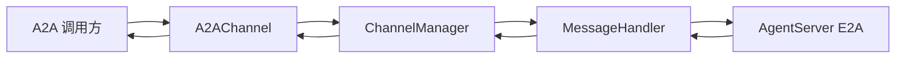

# A2A 接入说明

本文说明 Gateway 侧 **A2A Server**（`A2AChannel`）的实现位置、配置方式、与内部 `Message`/E2A 的对应关系及本地验证命令；出站 A2A（Agent 调外部）见 §7。

> **实现**：`jiuwenswarm/gateway/channel_manager/protocol/a2a/a2a_connect.py`（`A2AChannel` + `a2a-sdk`）。**入口进程**：`python -m jiuwenswarm.gateway.app_gateway`（`jiuwenswarm/gateway/app_gateway.py` 中注册并启动）。**冲突时**：以源码为准，并回头修正本文。

---

## 0. 文档位置与单一真源

| 位置 | 角色 |
|------|------|
| **docs/zh/A2A.md**（本文） | 接入与开发联调：模块、配置、映射、验证 |
| `jiuwenswarm/gateway/channel_manager/protocol/a2a/a2a_connect.py` | A2A HTTP 服务、`AgentCard`、请求/响应与 `Message` 互转 |
| `jiuwenswarm/gateway/app_gateway.py` | 环境变量读取、`A2AChannel` 构造与 `channel_manager.register_channel` |
| `jiuwenswarm/gateway/message_handler/message_handler.py` | 与 AgentServer 的 E2A 收发、内部 `Message` 编排 |
| `jiuwenswarm/gateway/channel_manager/channel_manager.py` | 频道注册与 `robot_messages` → `Channel.send` 派发 |
| [E2A-protocol.md](E2A-protocol.md) | Gateway↔AgentServer 内层协议 |

---

## 1. 职责边界

- **入站（本文）**：外部 A2A 客户端 → `A2AChannel` → `ChannelManager` → `MessageHandler` → E2A → AgentServer；回复沿同一路径返回，经 `TaskStatusUpdateEvent` / `TaskArtifactUpdateEvent` 输出（流式）或聚合结果（非流式）。
- **出站**：Agent 侧通过 A2A MCP Hub 等工具访问外部 A2A，接线在 AgentServer 适配层（见 §7），不在 `A2AChannel` 内实现。

---

## 2. 与 Web / ACP 通道的对照

| 项目 | Web | ACP | A2A（当前） |
|------|-----|-----|-------------|
| 绑定 | `WEB_HOST` / `WEB_PORT` / `WEB_PATH` | `ACP_GATEWAY_*` | `A2A_SERVER_*` |
| 配置来源 | 环境变量 + CLI（`--host` 等） | 仅环境变量 | 仅环境变量 |
| `.env` | `app_gateway` 启动时 `load_dotenv(get_env_file())`，即 `~/.jiuwenswarm/config/.env` | 同上 | 同上 |

---

## 3. 环境变量（Gateway）

在 `~/.jiuwenswarm/config/.env` 或进程环境中设置（`app_gateway.py` 读取）：

启用 A2A 前请先安装可选依赖：

```bash
pip install "jiuwenswarm[a2a]"
# 或（仓库/开发环境）
uv sync --extra a2a
```

| 变量 | 默认 | 说明 |
|------|------|------|
| `A2A_SERVER_ENABLED` | 未设则关闭 | `1` / `true` / `yes` / `on` 为开启 |
| `A2A_SERVER_HOST` | `127.0.0.1` | HTTP 监听地址；对外服务常用 `0.0.0.0` |
| `A2A_SERVER_PORT` | `19100` | 与 Web、ACP 端口勿冲突 |
| `A2A_SERVER_PATH` | `/a2a` | JSON-RPC 入口路径 |
| `A2A_SERVER_PROTOCOL_VERSION` | `1.0.0` | 写入 `AgentCard` 的 `AgentInterface.protocol_version` |
| `A2A_SERVER_CARD_PATH` | `/.well-known/agent-card.json` | Agent Card 对外路径 |
| `A2A_SERVER_EXTENDED_CARD_PATH` | `/agent/authenticatedExtendedCard` | Extended Card 对外路径 |
| `A2A_SERVER_APP_NAME` | `JiuwenSwarm Gateway A2A Server` | Agent Card `name` |
| `A2A_SERVER_APP_DESCRIPTION` | `A2A ingress for JiuwenSwarm Gateway` | Agent Card `description` |
| `A2A_SERVER_APP_VERSION` | `0.1.0` | Agent Card `version` |
| `A2A_SERVER_EXPOSE_REASONING` | `true`（默认开启） | 开启后思考（reasoning）内容以 working 状态的 `TaskStatusUpdateEvent` 输出（见 §6.2）；设为 `false`/`0`/`no`/`off` 时直接丢弃 |

AgentServer 连接仍由网关既有逻辑配置（例如 `AGENT_SERVER_URL` 等），与 A2A 监听端口独立。

当 `A2A_SERVER_ENABLED=true` 且未安装 `jiuwenswarm[a2a]`（或 `uv sync --extra a2a`）时，Gateway 主流程仍会继续启动；A2A 通道启动失败会在日志中输出明确安装指引。

---

## 4. 对外端点

- **JSON-RPC**：`http://{A2A_SERVER_HOST}:{A2A_SERVER_PORT}{A2A_SERVER_PATH}`
- **Agent Card**：`http://{host}:{port}/.well-known/agent-card.json`（路径由 `A2AChannelConfig.card_path` 定义，默认 `/.well-known/agent-card.json`）

`AgentCard` 在 `A2AChannel.start()` 内构造：`supported_interfaces[0].url` 指向上述 JSON-RPC；`capabilities.streaming` 与技能列表见源码。

---

## 5. 数据流（概要）



入站将 A2A `message.parts` 映射为 `Message.params` 的 `query` 与可选 `files`；不写入 `params["a2a"]` 等扩展结构。回包将内部 `Message.payload` 映射为 A2A `Part` 列表（含多模态与工具事件文本化）。

---

## 6. 字段映射摘要

### 6.1 请求（A2A → `Message`）

| A2A / 上下文 | 内部 |
|--------------|------|
| `task_id` 或生成值 | `Message.id`（与回包关联） |
| `context_id` | `Message.session_id` |
| `parts[].text` | 合并为 `params.query` |
| `parts` 中非文本（url / data / raw） | 字节落入接收目录 `JIUWENSWARM_FILE_SANDBOX_ROOT`（默认桌面 `JiuwenSwarm`）后写入 `params.files[]`，同时保留 `url` / `data` / `raw` |
| 元数据 | `Message.metadata` |

### 6.2 响应（`Message` → A2A）

| 内部 | A2A |
|------|-----|
| `payload.content`、工具相关事件等 | `Part(text=...)` 等，写入 `response` artifact |
| `payload.files[]` | `Part` 的 url / data / raw 等 |
| 思考内容（`chat.reasoning` 或 `chat.delta` 且 `source_chunk_type == "llm_reasoning"`） | 见下 |

**思考与正文的区分**：思考内容不会写入 `response` artifact。默认（`A2A_SERVER_EXPOSE_REASONING` 开启）以 working 状态的 `TaskStatusUpdateEvent` 输出，`status.message.parts[].metadata` 携带 `{"jiuwen_thought": true}` 标记（对齐 Google ADK 的 `adk_thought` 惯例），调用方可结构化识别或忽略；设为 `false`/`0`/`no`/`off` 时直接丢弃。

---

跨设备传文件的稳定性说明见 [A2A-跨设备改动说明.md](A2A-跨设备改动说明.md)。对话 Agent 上的 `a2a_send_message` 走 sidecar，可带 `file_paths`；`a2a_send_file` / `a2a_send_local_file` 仍由 swarm 的 A2A Gateway 注册。Gateway 源码未包含在当前分支时，出站初始化会跳过，入站和 sidecar 发送保持可用。

## 7. 出站 A2A（Agent 侧）

出站 A2A（本机 Agent 调用外部 A2A peer）由 **A2A Gateway** 模块提供，移植自 OpenClaw `a2a-gateway` 插件。入站 A2A 服务器（§1–§6，`a2a_connect.py`）与远场发现（`react.a2x_registry`）已存在并复用；本节仅描述**新增的出站能力**：出站客户端、NAT 隧道、出站文件工具。

### 7.1 组件与实现位置

| 组件 | 实现文件 | 说明 |
|------|----------|------|
| 出站客户端 | `jiuwenswarm/agents/harness/common/a2a_gateway/outbound_client.py` | 基于 `a2a-sdk` 的 `ClientFactory`/`create_client`，含熔断、重试、传输回退（JSONRPC>REST>gRPC） |
| NAT 隧道 | `jiuwenswarm/agents/harness/common/a2a_gateway/tunnel/session.py` | WebSocket 中继客户端（REGISTER/FORWARD/心跳/指数退避重连），跨 NAT 互通 |
| 出站文件工具 | `jiuwenswarm/agents/harness/common/a2a_gateway/tools.py` | `a2a_send_file` / `a2a_send_local_file` 两个 agent 工具 |
| 运行时单例 | `jiuwenswarm/agents/harness/common/a2a_gateway/runtime.py` | 进程级 `outbound_client` / `tunnel` 持有器 |
| Swarm provider | `jiuwenswarm/agents/swarm/providers/a2a_gateway.py` | `swarm.a2a_send` 工具元素（`@harness_element`） |
| 启动接线 | `jiuwenswarm/gateway/app_gateway.py` | A2A Gateway 段读取配置，拉起 `A2AOutboundClient` + `TunnelSession` |

### 7.2 配置

在 `config.yaml` 顶层加 `a2a_gateway` 段（模板见 `jiuwenswarm/resources/config.team.distributed.{leader,teammate}.yaml`），或用 `A2A_*` 环境变量驱动（与 `A2A_SERVER_*` 一致）。

```yaml
a2a_gateway:
  enabled: true                       # 出站总开关；false 时 a2a_send_* 工具不注册
  default_agent_id: "main"            # 远端路由默认 agentId
  agent_response_timeout_ms: 300000
  peers:
    - name: "remote-coder"
      agent_card_url: "http://100.64.0.2:19100/.well-known/agent-card.json"
      auth:
        type: bearer                  # bearer | api_key
        token: "<PEER_INBOUND_TOKEN>"
      tunnel_device_id: ""            # 经中继可达时填 peer 的 deviceId
  security:
    max_file_size_bytes: 52428800     # 50 MB 单文件上限
    allowed_mime_types: []            # 空 = 全部
    peer_token: ""                    # 出站默认 bearer token（A2X 注册中心解析出的 peer 自动带上；peers[].auth 优先）
  resilience:
    retry: { max_retries: 3, initial_delay_ms: 500, max_delay_ms: 10000 }
    circuit_breaker:
      enabled: true
      failure_threshold: 5            # 连续失败触发开路
  tunnel:
    relay_url: "ws://relay.example.com:18789"   # 仅跨 NAT 时配置
    device_id: "<LOCAL_DEVICE_ID>"
    local_service_port: 19100         # 转发到本地入站 A2A 端口
```

环境变量（优先级低于 config.yaml 段）：

| 变量 | 默认 | 说明 |
|------|------|------|
| `A2A_GATEWAY_ENABLED` | 未设则关闭 | 出站总开关 |
| `A2A_TUNNEL_RELAY_URL` | 空 | 中继地址（`ws://` 或 `wss://`） |
| `A2A_TUNNEL_DEVICE_ID` | 空 | 本机设备身份 |
| `A2A_TUNNEL_HEARTBEAT_MS` | `15000` | 心跳间隔 |
| `A2A_TUNNEL_HEARTBEAT_TIMEOUT_MS` | `45000` | 静默超时强制重连 |
| `A2A_TUNNEL_RECONNECT_DELAY_MS` | `1000` | 指数退避起始 |
| `A2A_TUNNEL_MAX_RECONNECT_DELAY_MS` | `30000` | 退避封顶 |
| `A2A_TUNNEL_MAX_RECONNECT_ATTEMPTS` | `0` | `0` = 无限重连 |
| `A2A_TUNNEL_DATASET` | 空 | enriched REGISTER 用 |
| `A2A_TUNNEL_SERVICE_ID` | 空 | enriched REGISTER 用 |

### 7.3 Agent 工具

启用后，每个 team 成员（leader / teammate）注册两个工具：

| 工具 | 参数 | 用途 |
|------|------|------|
| `a2a_send_file` | `peer_name`、`file_uri` *或* `abs_file_path`、`agent_id?`、`message?` | 向 peer 发文件（URI 或本地路径），返回远端文本响应 |
| `a2a_send_local_file` | `peer_name`、`abs_file_path`、`agent_id?`、`message?` | 按本机路径发文件，传输名恒为 basename，避免公网 URI 与大段 base64 |

`agent_id` 为非标准路由扩展（对应 OpenClaw `message.agentId`），存入消息 `metadata`，JSON-RPC/REST 最可靠，gRPC 可能丢弃未知字段。单文件上限 50 MB（`security.max_file_size_bytes`）。

### 7.4 端到端验证

1. 启动两端 Gateway（`A2A_SERVER_ENABLED=true`），互为 peer 配置（`peers` 段含对端 `agent_card_url` + token）。
2. 任一端 Agent 调用 `a2a_send_file` 或 `a2a_send_local_file`，`peer_name` 指向对端。
3. 对端入站 A2A 收到文件，落盘并触发 Agent 处理（入站落盘逻辑见 `a2a_connect.py`）。
4. 跨 NAT 场景：两端都配 `tunnel.relay_url` + `tunnel.device_id`，peer 的 `tunnel_device_id` 填对端 deviceId；出站客户端自动对隧道 peer 过滤 gRPC，走 HTTP 经中继转发。

### 7.5 不做的事

- 不重写入站 `a2a_connect.py`（已工作）。
- 不重写 A2X registry（与 OpenClaw registry-client 重叠，复用 `react.a2x_registry`）。
- 不移植 OpenClaw Gateway RPC executor（用 JiuwenSwarm 已有 Message 派发替代）。
- 不移植 mDNS / DNS-SD / Quorum 发现（用 A2X 做远场发现；如需可单独立项）。

---

## 8. 本地验证（示例）

非流式：

```bash
curl -sS -X POST "http://127.0.0.1:${A2A_SERVER_PORT:-19100}${A2A_SERVER_PATH:-/a2a}" \
  -H 'Content-Type: application/json' \
  -d '{"jsonrpc":"2.0","id":"t1","method":"SendMessage","params":{"message":{"messageId":"m1","contextId":"c1","role":"ROLE_USER","parts":[{"text":"ping"}]}}}'
```

流式：

```bash
curl -sS -N -X POST "http://127.0.0.1:${A2A_SERVER_PORT:-19100}${A2A_SERVER_PATH:-/a2a}" \
  -H 'Content-Type: application/json' \
  -d '{"jsonrpc":"2.0","id":"t2","method":"SendStreamingMessage","params":{"message":{"messageId":"m2","contextId":"c2","role":"ROLE_USER","parts":[{"text":"ping"}]}}}'
```

需同时启动 AgentServer 与 Gateway，且 `A2A_SERVER_ENABLED=true`。

---

## 9. 已知扩展点

- 鉴权、限流、超时与观测指标：由网关或前置代理统一补强时，保持 `A2AChannel` 只做协议与消息映射为宜。
- `jiuwenswarm/resources/.env.template` 未预置 A2A/ACP 键时，可在本地 `.env` 手工追加（与 §2 一致）。
---

## 返回导航

- [返回文档首页](../README.md)
- [返回项目首页](../../README_CN.md)